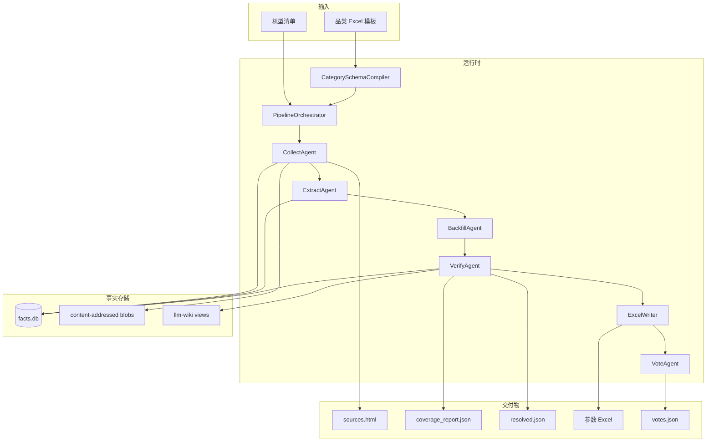

# terminal-insight-v2 架构设计

> 状态：Design Baseline  
> 关联文档：[TECHNICAL_DESIGN.md](./TECHNICAL_DESIGN.md) · [CATEGORY_TEMPLATE_SPEC.md](./CATEGORY_TEMPLATE_SPEC.md)  
> 首期品类：手机、智能手表、智能眼镜

## 1. 目标与非目标

### 1.1 目标

1. **证据优先**：每个非空字段都能追溯到原始快照（HTML / JSON / Markdown）与 URL。
2. **采集与提取解耦**：第一阶段只采集与归档；第二阶段才做字段提取。
3. **冲突可保留**：多信源不同说法并列保存，不在抽取时静默压平。
4. **补链闭环**：空缺字段定向检索，最多三轮；每轮记录覆盖率增量。
5. **品类插件化**：后续新增品类**只提供一个 Excel 模板**，无需改 Python / 提示词 / 数据库 Schema。
6. **可审计交付**：中间产物始终可供人工审核；对外报告只使用 Gold 资料。

### 1.2 非目标（首期）

- 不把 Excel / Vote 结果当作事实源回写。受众审阅是决策视角派生，不得补写新事实。
- 不维护两套独立 Wiki 仓库（避免复制与漂移）。
- 不要求中间阶段人工闸门阻塞流水线（审核产物保留，异步生效）。
- 不继承 V1 的 RAG 多引擎栈、Infini Discovery、全局可变 `settings.out_dir` 与有损 Excel 回读。
- 不伪造原始 HTML：抓不到就留痕失败，不编造 raw。

### 1.3 成功指标

| 指标 | 目标 |
|------|------|
| 官方来源存在时覆盖率 | 100%（官网参数页 + 官方商城） |
| 非空 Gold 字段证据覆盖率 | 100%（每字段 ≥1 个 snapshot_id + snippet） |
| 错机型进入 Gold 信源 | 0 |
| 每机目标来源数 | ≈10（软目标，不硬凑） |
| 补链轮次上限 | 3 |
| 新品类上线路径 | 仅放入 Excel 模板即可跑通六阶段 |

---

## 2. 已确认决策

| 议题 | 决策 |
|------|------|
| Wiki 组织 | **一个事实库**，`raw / canonical / gold` 分层；研究索引与报告索引分离 |
| 对外报告资料 | **仅 Gold**；证据不足则留空，不拿自动校验结果冒充对外结论 |
| 新品类交付物 | **一个多 Sheet Excel 工作簿**（输出模板 + 字段定义 + 品类配置 + 可选信源配置） |
| 原始存储 | HTML **永久保存**；动态页降级到 JSON / 渲染 DOM / Markdown-only；失败留痕 |
| Markdown / JSON | 清洗产物，同时是**准事实源**（可由同一 raw 重生成，带转换器版本） |
| 人工审核 | 不阻塞流水线，但保留中间产物；最重要的是 Stage 1 信源机型一致性 |
| 锁定字段 / 拒绝信源 | 支持；见 §7 |
| 机型清单 | 沿用现有 discovery 清单，并叠加权威第三方信源策略 |
| 项目形态 | 独立仓库 / 目录 `terminal-insight-v2`，不在 V1 上继续叠加 |

---

## 3. 架构原则

1. **SoT 分层**  
   - Raw：不可变抓取快照  
   - Canonical：规范化正文与字段断言（可重算）  
   - Gold：人工审核后的设备—来源绑定与可对外字段  
   - Excel / HTML / Wiki 页面：派生视图，可完全重建

2. **一字段多断言**  
   事实主干为：

   ```text
   Source → Snapshot → FieldAssertion → Verification → Resolution
   ```

   禁止「每个字段只能存一份证据」的主键设计。

3. **阶段单向数据流**  
   下游可触发上游补做（如补链），但不得无版本地覆盖上游原始断言。

4. **品类 Schema 驱动一切**  
   采集提示、抽取 JSON Schema、缺口检测、补链关键词、校验器、Excel 列、Vote 投影均来自编译后的 `category-schema.json`。

5. **幂等与可恢复**  
   每个阶段以 `(device_id, stage, input_revision)` 为幂等键；失败可重试；不静默空跑。

---

## 4. 系统边界与组件



| 组件 | 职责 |
|------|------|
| CategorySchemaCompiler | 将 Excel 模板编译为不可变品类 Schema |
| PipelineOrchestrator | 阶段调度、账本、断点恢复、失效传播 |
| CollectAgent | 发现 URL、抓取、归档 raw/canonical、生成 sources.html |
| ExtractAgent | 仅读快照，逐源产出 FieldAssertion |
| BackfillAgent | 按空缺字段定向检索并回灌 Collect/Extract |
| VerifyAgent | 机型一致性、字段证据支持、冲突汇总、Resolution |
| ReviewService | 拒绝绑定 / 拒绝来源 / 锁定字段 / 发布 Gold |
| ExcelWriter / VoteAgent | 从 Resolution（研究用）或 Gold（对外）生成交付物 |
| WikiIndexer | 维护 research / report 两个检索索引 |

---

## 5. 六阶段职责


### Stage 1 — 采集（Collect）

| | |
|--|--|
| **目标** | 为每款设备尽可能收集权威来源正文，不做字段结论 |
| **输入** | 窗口发现的机型清单，或定向 `targets.json`（跳过 Discovery）+ 品类 Schema + 信源策略 |
| **输出** | Source / Snapshot / DeviceSource；raw + content.md/json；`sources.html`；`collection_manifest.json` |
| **必采** | 若官网参数页、官方商城存在，则必须收录；不存在则记录 `not_available`，禁止硬凑 |
| **软目标** | ≈10 个来源；不足时记录原因，不因凑数引入低质页 |
| **禁止** | 字段抽取、冲突仲裁、写入 Gold |

### Stage 2 — 提取（Extract）

| | |
|--|--|
| **目标** | 对每个通过机型初检的快照独立提取字段断言 |
| **输入** | Canonical Markdown / JSON 快照 |
| **输出** | `FieldAssertion[]` |
| **闸门** | 任意非空断言必须关联 `snapshot_id` + 原文 `snippet` |
| **禁止** | 联网抓取；把多源合并成单一最终值并丢弃落选说法 |

### Stage 3 — 补链（Backfill）

| | |
|--|--|
| **目标** | 仅针对空缺或证据不足字段做豆包定向检索 |
| **输入** | `coverage_report.json` 中的缺口 |
| **输出** | 新 Source / Snapshot / FieldAssertion |
| **闸门** | 查询含品牌 + 完整机型 + 字段关键词；搜索摘要仅作线索，必须重新抓取正文 |
| **上限** | 最多 3 轮；无覆盖率增量则提前停止 |

### Stage 4 — 校验（Verify）

| | |
|--|--|
| **目标** | 先验机型身份，再验字段准确性，生成 Resolution |
| **输入** | 全部断言与快照 |
| **输出** | VerificationResult + ResolutionResult + coverage |
| **闸门** | 错机型来源不得进入 Resolution 的采纳集合；冲突默认并列展示 |
| **循环** | 仍有缺口且轮次 < 3 → 回到 Stage 3 |

### Stage 5 — Excel

| | |
|--|--|
| **目标** | 从 Resolution / Gold 视图生成业务表 |
| **输出** | 参数表、字段信源表、冲突与校验旁注（Vote 写入「亮点投票」「受众视角」） |
| **闸门** | Excel 可完全由数据库重建；禁止把 Excel 回读为 SoT |

### Stage 6 — Vote

| | |
|--|--|
| **目标** | AAA–FFF 六套参考系 × 取景框热点提报；LLM 方向聚类（展示）；四类受众对每条热点直接打分；可选假说双跑对照 |
| **输入** | 与 Excel 同源的 `resolved.json` 投影；可选 `hypotheses.json`（研究层，schema v2） |
| **输出** | `votes.json`（六票 + LLM 聚类 + 四受众审阅 + 假说对照/争议）；回填 Excel「亮点投票」「受众视角」「假说对照」 |
| **闸门** | `input_revision` 变化时覆盖旧 vote；禁止编造投影外机型；受众审阅与假说对照不得补写事实 |

### 研究层 — 假说与跨 run 结算（非 Stage）

| | |
|--|--|
| **目标** | 将上年蓝皮书蒸馏为可证伪假说（带页码与 confidence）；季度 Vote 双跑对照；年底对多 run 做确定性结算（含 alert） |
| **输入** | `data/hypotheses/{category}-YYYY.json`；各季 `data/runs/{id}/votes.json`（仅 `hypothesis_reviews`） |
| **输出** | `settlement.json` / `settlement.xlsx`（CLI `ledger settle`） |
| **纪律** | 假说、对照、结算均为研究派生，**禁止**写回 `resolved.json` / facts.db / Gold；不编入 `STAGES`；disputes 不参与判决 |

### 研究层 — 机型四象限图（非 Stage）

| | |
|--|--|
| **目标** | 将价格 / 电池等结构量落成 CCC 切片二维图；Vote 提名机型加圈 |
| **输入** | `resolved.json`（解析 display_text）；可选 `votes.json` |
| **输出** | `quadrant.json` + `quadrant.html`（Vote 结束后自动写；亦可 `viz quadrant --run`） |
| **纪律** | 价位带与象限归属是视图规则，禁止写回事实库；图自称 CCC 切片，不假装六套参考系 |

---

## 6. 信任分层与 LLM Wiki

```text
llm-wiki/
├── raw/              # 永久原始 HTML / JSON / MD 快照
├── canonical/        # 清洗正文 + 自动字段断言（研究可用）
├── gold/             # 人工审核后发布的设备 / 来源页
└── indexes/
    ├── research/     # 含未拒绝的 raw/canonical
    └── report/       # 仅 gold；对外报告唯一入口
```

| 层 | 谁写入 | 谁可读 | 用途 |
|----|--------|--------|------|
| Raw | Collect | 研究索引、重解析 | 审计、再清洗 |
| Canonical | Extract / Verify | 研究索引、补链 | 挖掘、内部分析 |
| Gold | ReviewService（人工确认后） | 报告索引、对外 Excel | 对外报告 |

**人工审核后的机型进入黄金信源** 拆成三级：

1. **来源级 Gold**：确认「该 URL 属于该机型」→ 进入 gold source pool。  
2. **字段级 Gold**：确认「该字段说法被原文支持」→ 字段可对外。  
3. **设备页 Gold**：整机可发布 → 进入 report index。

仅完成 (1) 不足以把全部字段自动升为 Gold。

---

## 7. 人工审核语义

流水线**不阻塞**；审核结果异步写入并触发下游失效重算。

### 7.1 锁定字段（Lock Field）

人工确认某字段最终值后：

- 后续自动重跑**不得覆盖**该值；
- 仍可追加新证据；
- 若新证据与锁定值冲突 → 生成待复核 issue，不静默改写。

### 7.2 拒绝信源（两级）

| 级别 | 含义 | 影响范围 |
|------|------|----------|
| 拒绝绑定 | 该 URL **不属于**当前机型 | 仅该 `device_id + source_id` |
| 全局拒绝来源 | 垃圾站 / 恶意 / 长期不可信 | 所有设备禁止再绑定该 URL（或 host 规则） |

默认使用「拒绝绑定」；全局拒绝需显式操作。

### 7.3 Stage 1 信源审核（最重要）

`sources.html` 按机型展示：来源类型、权威等级、页面识别机型、与目标是否一致、标题/片段、原始快照入口、自动状态（通过 / 存疑 / 拒绝）。人工可批量确认或拒绝绑定。

---

## 8. 信源策略

| 等级 | 类型 | 要求 | 用途 |
|------|------|------|------|
| P0 | 官网参数页、官方商城 | 存在即必采 | 规格与国内价格主口径 |
| P1 | 官方新闻稿 / 发布会页、权威专业测评 | 优先 | 发布时间、实测与宣发 |
| P2 | 大型参数库 / 主流科技媒体 | 补充 | 交叉确认与缺口 |
| P3 | 搜索摘要 / 聚合转载 | 仅线索 | **不得**单独成为最终字段证据 |

权威第三方基线（可按品类模板扩展）：ZOL、快科技、充电头网、锋潮、Notebookcheck、The Verge、Tom's Guide、Android Authority 等（与现有 V1 `SOURCE_SITES` 对齐并允许模板覆盖）。

---

## 9. 质量属性

| 属性 | 要求 |
|------|------|
| 可追溯 | 字段 → assertion → snapshot → blob → URL |
| 幂等 | 同输入 revision 重跑不产生重复事实 |
| 可恢复 | 任意阶段可从账本与产物续跑 |
| 限流 | 豆包 / LLM / 抓取均有 QPS 与并发上限 |
| 安全 | 原始正文视为不可信；禁止 prompt injection 改变流程 |
| 可扩展 | 新品类零代码；站点 adapter 可选增强，非必需 |

---

## 10. 与 V1 的关系

| 复用 | 不继承 |
|------|--------|
| 品类字段经验、站点 adapter、URL 机型匹配、Excel 样式、Vote 角色逻辑、豆包检索客户端 | 全局可变 out_dir、RAG 多引擎、Infini、5 源硬上限、单证据 field_evidence 主键、Excel 回读 SoT |

V1 数据经迁移器导入，标记 `provenance_level`；证据不完整者**不得**直接升 Gold。

---

## 11. 里程碑（文档落地后的实现顺序）

1. **M1 数据底座**：Schema、blob store、run ledger  
2. **M2 采集闭环**：官方必采、第三方发现、sources.html  
3. **M3 断言提取**：逐源提取与冲突展示  
4. **M4 补链校验**：三轮状态机 + 身份/字段校验  
5. **M5 Excel + Vote**：可重建交付  
6. **M6 品类插件 + 迁移**：手机/手表/眼镜模板 + 虚构第四品类契约测试 + V1 导入  

详细接口、表结构与状态机见 [TECHNICAL_DESIGN.md](./TECHNICAL_DESIGN.md)。  
Excel 模板协议见 [CATEGORY_TEMPLATE_SPEC.md](./CATEGORY_TEMPLATE_SPEC.md)。
