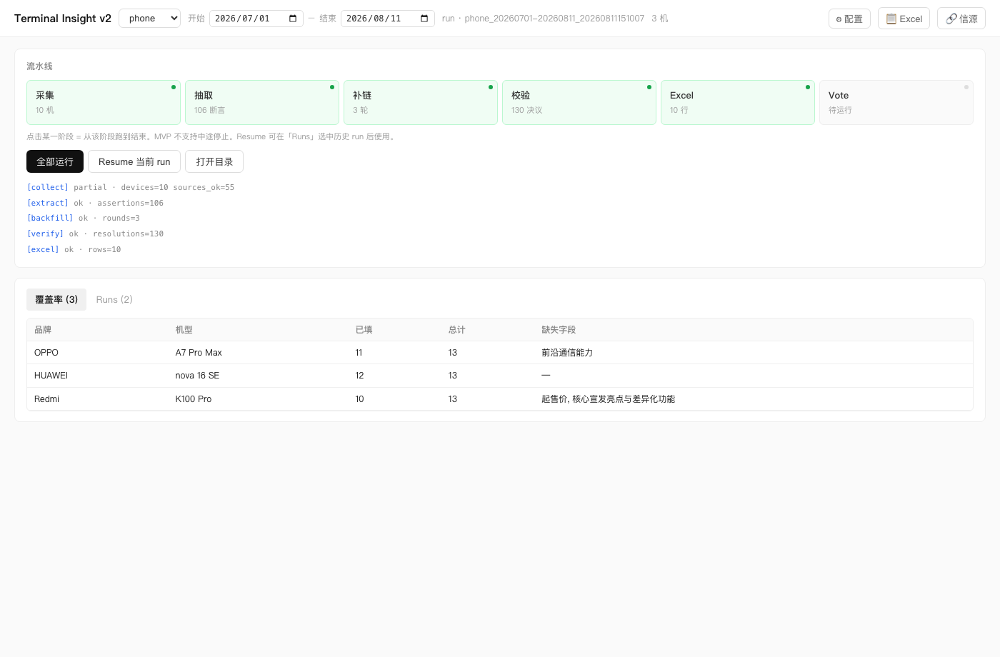
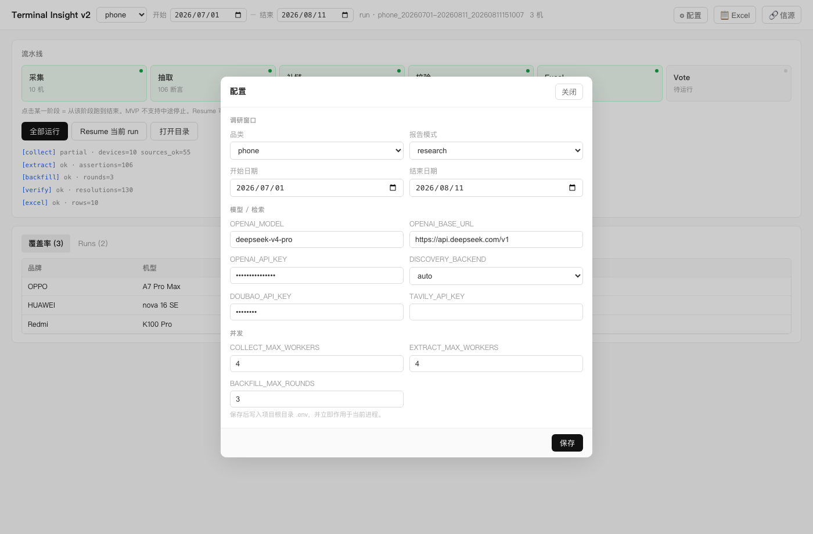
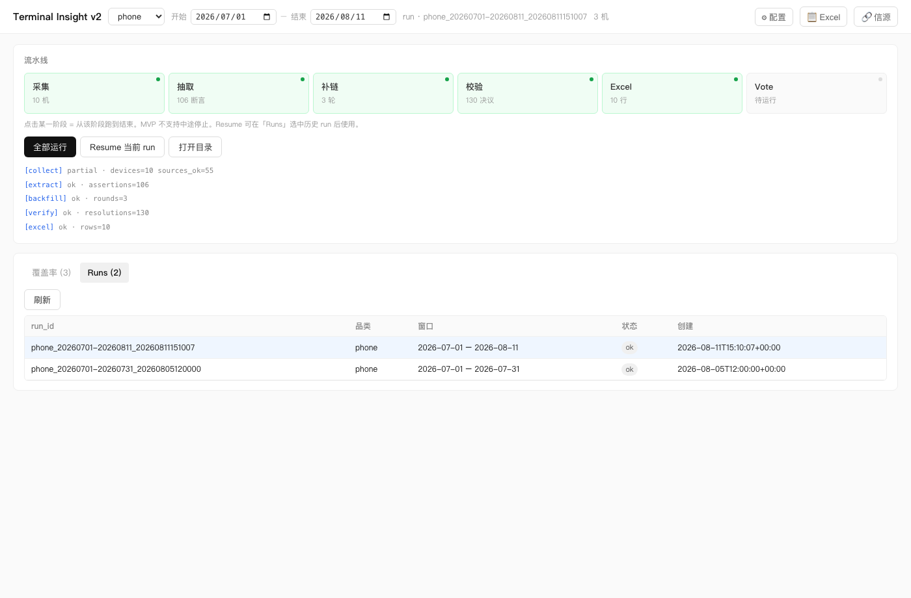
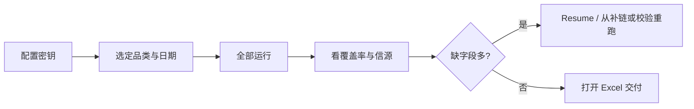

# Terminal Insight v2 — GUI 用户使用手册（浅色版）

> 适用对象：业务操作 / 实施交付  
> 适用形态：桌面 GUI（`python run_gui.py` 或打包后的 `terminal-insight-v2.exe`）  
> 截图版本：**浅色主题**（当前 `main` 默认界面）  
> 深色主题手册见：[GUI用户使用手册-深色版.md](./GUI用户使用手册-深色版.md) / [PDF](./GUI用户使用手册-深色版.pdf)  
> 关联文档：[客户交接说明.md](./客户交接说明.md) · [PACKAGING.md](../PACKAGING.md)

---

## 1. 这是什么

Terminal Insight v2 GUI 用于在本机完成智能终端（手机 / 手表 / 眼镜）调研流水线：

```text
采集 → 抽取 → 补链 → 校验 → Excel → Vote
```

你可以用图形界面完成：配置密钥与日期、选择**窗口发现或定向机型**、一键跑批、查看覆盖率、打开 Excel / 信源页、切换历史 Run。

---

## 2. 启动方式

| 方式 | 命令 / 操作 |
|------|-------------|
| 源码 | 在项目根目录执行 `python run_gui.py`（或 `python -m terminal_insight_v2.gui`） |
| 打包版（Windows） | 双击 `terminal-insight-v2.exe`（需保留整个文件夹，勿只拷贝 exe） |

**首次启动前准备**

1. Windows 需已安装 Edge **WebView2**（Win11 一般自带）  
2. 准备好 API Key（DeepSeek / 豆包搜索；Tavily 可选）  
3. 确认对程序目录有写权限（会生成 `.env` 与 `data/`）

---

## 3. 主界面总览

启动后进入主界面，大致分为四块：**顶栏**、**流水线**、**日志**、**覆盖率 / Runs**。



| 区域 | 作用 |
|------|------|
| ① 顶栏 | 品类、日期窗口、采集方式（窗口发现 / 定向机型）、当前 run、配置 / Excel / 信源入口 |
| ② 流水线卡片 | 六个阶段状态；点击某阶段 = 从该阶段跑到结束 |
| ③ 操作按钮与日志 | 全部运行 / Resume / 打开目录；下方为阶段摘要日志 |
| ④ 覆盖率 / Runs | 查看字段覆盖情况，或切换历史批次 |

**阶段状态颜色**

| 状态 | 含义（浅色主题） |
|------|------|
| 灰点 · 待运行 | 卡片浅灰，尚未执行 |
| 蓝点闪烁 · 运行中 | 卡片淡蓝，当前正在跑 |
| 绿点 · 完成 | 卡片淡绿；`ok` / `skipped` / `partial` 都算完成（采集常显示「N 机」） |
| 红点 · 失败 | 卡片淡红，本阶段出错 |

---

## 4. 首次配置（必做）

1. 点击右上角 **⚙ 配置**  
2. 填写调研窗口、模型与检索密钥、并发参数  
3. 点击 **保存**（写入项目根 / exe 同级的 `.env`，立即生效）



### 4.1 调研窗口

| 项 | 说明 |
|----|------|
| 品类 | `phone` / `watch` / `glasses`（对应 `category_templates/*.xlsx`） |
| 报告模式 | `research`（研究）或 `gold`（更严格留空） |
| 开始 / 结束日期 | 发布日期窗口，含起止日 |

### 4.2 模型 / 检索（与本程序对应关系）

| 配置项 | 写入 `.env` | 用途 |
|--------|-------------|------|
| OPENAI_MODEL | `OPENAI_MODEL` | 抽取用模型，默认 `deepseek-v4-pro` |
| OPENAI_BASE_URL | `OPENAI_BASE_URL` | 默认 `https://api.deepseek.com/v1` |
| OPENAI_API_KEY | `OPENAI_API_KEY` | DeepSeek（OpenAI 兼容）密钥 |
| DISCOVERY_BACKEND | `DISCOVERY_BACKEND` | `auto` / `doubao` / `tavily` |
| DOUBAO_API_KEY | `DOUBAO_API_KEY` | 豆包搜索（发现机型 / 补链） |
| TAVILY_API_KEY | `TAVILY_API_KEY` | Tavily 搜索（可选备用） |

> `auto`：优先豆包，不可用时尝试 Tavily。  
> 密钥只显示为密文；保存后不会整文件覆盖 `.env` 中其他未展示键。

### 4.3 并发

| 项 | 建议 |
|----|------|
| COLLECT_MAX_WORKERS | 默认 4；过大易触发限流 |
| EXTRACT_MAX_WORKERS | 默认 4 |
| BACKFILL_MAX_ROUNDS | 默认 3（补链轮次上限） |

顶栏的品类与日期修改后也会**自动快速保存**到 `.env`。

---

## 5. 跑一批调研（标准流程）

### 步骤 A — 设定范围

在顶栏选择：

1. **品类**（如 `phone`）  
2. **开始日期 / 结束日期**（如 `2026-07-01` ~ `2026-08-16`）  
3. **采集方式**（见下一步）

日期窗口在两种采集方式下都有效：窗口发现用它找新机；定向机型用它规划信源与过滤发布时间。

### 步骤 B — 选择采集方式

顶栏下拉可切换：

| 方式 | 做什么 | 何时用 |
|------|--------|--------|
| **窗口发现**（默认） | 按日期窗搜索本窗口新机，再抓取官网 / 商城 / 第三方 | 普查某段时间的新品 |
| **定向机型** | 跳过发现，只抓你确认的「品牌 + 型号」 | 已知清单、复跑指定几款 |

**定向机型操作**

1. 顶栏下拉选 **定向机型**，再点 **定向 · N 机**  
2. 按「一行一款」粘贴，例如：

```text
华为 | Mate X7
OPPO, A7 Pro Max
Redmi Note 17 Pro
```

3. 点 **解析预览**，核对品牌 / 型号（可改、可删）  
4. 点 **确认** 后，按钮会显示已确认台数（如「定向 · 3 机」）  
5. 再点 **全部运行**

分隔符支持竖线 `|`、逗号、Tab 或空格。规则：

- **一行一台**，不会把「品牌列表 × 型号列表」做成笛卡尔积  
- 只有型号、没有品牌的行会报错，需补全后再确认  
- 清单写入本次 run 的 `targets.json`，**不写入** `.env`  
- 定向模式仍要抓网页和后续 LLM；只是不再做窗口发现。补链检索仍可能用到豆包 Key  

未确认清单时点「全部运行」，会提示「定向机型为空」并打开该面板。

### 步骤 C — 全部运行

点击蓝色按钮 **全部运行**。

系统将按顺序执行：`collect → extract → backfill → verify → excel → vote`。  
`vote` 按六套参考系各提名 2–3 个热点；LLM 做方向聚类（展示用）；四类受众（工信/监管、消费者、终端企业、上下游制造商）对每条热点直接打分，写入 `votes.json`，并回填 Excel「亮点投票」与「受众视角」。受众结论是决策视角，不是新事实。

六套取景框名称：路线标尺 / 巧思定义 / 价位规格 / 选题展开 / 证据定位 / 痛点购机。

### 步骤 D — 观察进度

任务一开始就会绑定**本次** run id（不必等整条流水线结束）。之后：

- 某一阶段一结束，对应卡片立刻变绿（`partial` 也算完成，采集常显示「3 机」）  
- 下一个未完成阶段自动显示「运行中」  
- 日志区出现类似：

```text
[collect] partial · devices=3 sources_ok=24
[extract] ok · assertions=66
…
```

> **注意**：当前版本**不支持中途停止**。请勿强制结束进程，以免 run 半成品。整批可能需数十分钟。关掉 GUI 窗口会中断本次跑批。

### 步骤 E — 查看结果

跑完后可用顶栏 **📋 Excel / 🔗 信源** 或 **打开目录** 查看产物（详见下一节）。「亮点投票」与「受众视角」在 Vote 完成后写入同一份 xlsx。

---

## 6. 如何查看 Excel 和信源

采集完成后即可看信源；跑到 **excel** 阶段后才有参数表。入口都在主界面**右上角**与流水线区按钮。


### 6.1 查看 Excel（参数表）

**前提**：当前 run 已成功跑完 **excel** 阶段（阶段卡片为绿色「完成」，且显示行数）。

**操作（任选其一）**

1. 点击顶栏 **📋 Excel**  
   - 系统用系统默认程序打开（Windows 一般为 Excel / WPS，macOS 为 Numbers 或 Excel）  
2. 或点流水线区 **打开目录**，在文件夹中双击 `*.xlsx`  
3. 或在 **Runs** 中先点选目标 run，再点 **📋 Excel**（避免打开错批次）

**按钮为灰色时**：说明当前 run 还没有 Excel 产物 → 先跑到 excel，或在 Runs 里切换到已完成的批次。

**Excel 里通常有哪些 Sheet**

| Sheet（常见） | 内容 |
|---------------|------|
| 参数主表（品类名） | 品牌、机型、发布时间与各规格字段 |
| 字段信源 | 每个字段对应的展示值、策略、来源 URL |
| 冲突与校验 | 校验/冲突问题，便于人审 |
| 亮点投票 | Vote 结果：参考系、取景框、热点、品牌、机型、说明 |
| 受众视角 | 四类受众对每条热点提名的相关度与行动启示 |

文件路径示例：

```text
data/runs/phone_20260701-20260811_20260811151007/phone_20260701-20260811.xlsx
```

### 6.2 查看信源（sources.html）

**前提**：当前 run 已完成 **collect**（或至少已写出 `sources.html`）。

**操作（任选其一）**

1. 点击顶栏 **🔗 信源** → 用默认浏览器打开 HTML 页  
2. 或 **打开目录** 后双击 `sources.html`（也可能是 `sources_10phone.html` 这类带数量的文件名）  
3. 切换历史批次：先在 **Runs** 点选对应 run，再点 **🔗 信源**

**信源页用来干什么**

- 核对「发现了哪些机型」  
- 检查每机官网 / 商城 / 第三方链接是否齐全、是否串机型  
- 作为抽取前的人工抽查入口  

路径示例：

```text
data/runs/phone_20260701-20260811_20260811151007/sources.html
```

### 6.3 打开整个产物目录

点击 **打开目录**，可看到本次 run 的全部文件：

```text
data/runs/{category}_{start}-{end}_{时间戳}/
  sources.html            ← 信源页
  *.xlsx                  ← 参数 Excel（含「亮点投票」「受众视角」）
  targets.json            ← 定向机型清单（仅定向模式）
  votes.json              ← 六参考系投票 + 四受众审阅原文
  coverage_report.json    ← 覆盖率（GUI 表格同源）
  steps.json              ← 各阶段状态与指标
  collection_manifest.json
  assertions.jsonl
  …
```

### 6.4 对照表

| 想看什么 | 点哪里 | 何时可用 |
|----------|--------|----------|
| 参数 Excel / 亮点投票 / 受众视角 | 顶栏 **📋 Excel** | excel 完成；投票与受众 Sheet 需再跑完 vote |
| 机型与链接 | 顶栏 **🔗 信源** | collect 完成 |
| 全部文件 | **打开目录** | 已有当前 run |
| 历史某次的表/信源 | Runs 点选该行 → 再点 Excel / 信源 | 该 run 已有对应产物 |

---

## 7. 从某一阶段重跑

在流水线卡片上**点击某一阶段**（如「抽取」）= **从该阶段一直跑到结束**。

典型场景：

- 采集已完成，只想重跑抽取及之后 → 点 **抽取**  
- 只要重新出 Excel → 点 **Excel**（需已有校验结果）  
- 只要重跑投票 → 点 **Vote**（需已有 `resolved.json`）

运行中不可再点阶段（卡片呈禁用态）。

---

## 8. 覆盖率表

主界面下方切换到 **覆盖率** Tab，查看每机已填字段与缺失字段。


| 列 | 含义 |
|----|------|
| 品牌 / 机型 | 设备身份 |
| 已填 / 总计 | 字段填充进度 |
| 缺失字段 | 尚未决议或为空的字段名 |

覆盖率在跑完 **verify** 后才有完整数据。可据此决定是否 Resume 或调整日期后重跑。

---

## 9. 历史 Runs 与 Resume

切换到 **Runs** Tab，可浏览近期批次并点选切换当前 run。



| 操作 | 说明 |
|------|------|
| 点击某行 | 切换当前 run，刷新覆盖率与产物按钮（含 Excel / 信源） |
| 刷新 | 重新拉取 run 列表 |
| Resume 当前 run | 在已选中的 run 上继续跑（适合中断后续阶段） |

列表字段：`run_id`、品类、日期窗口、状态、创建时间。

---

## 10. 推荐操作节奏



1. 先用短日期窗口或 **定向 2–3 机** 试跑，确认 `sources.html` 机型无串号  
2. 普查再用 **窗口发现** 跑完整窗口  
3. 用覆盖率与 Excel「字段信源」做人审  
4. 打开「亮点投票」看六套取景框提名，打开「受众视角」看谁该关注、能做什么；二者都不是 Q2 长文，受众结论不是新事实  
5. 对外交付时注意 `REPORT_MODE`（research / gold）语义差异  

---

## 11. 常见问题

| 现象 | 处理 |
|------|------|
| 双击无窗口（Windows） | 安装 WebView2；检查杀软；换短路径目录 |
| 配置保存无效 | 目录无写权限 → 移到「文档」等可写位置 |
| 采集为空 | 窗口发现：检查 `DOUBAO_API_KEY` / `TAVILY_API_KEY` 与网络。定向：先确认清单，再看抓取是否失败 |
| 提示「定向机型为空」 | 先解析预览并点 **确认**；下拉须为「定向机型」 |
| 定向仍出现未点名的机型 | 确认顶栏是定向且已确认清单；补链不会新增机型，只会给已有机补字段 |
| 阶段卡片一直「待运行」 | 需本版本（进度修复后）；旧版要等整批结束才翻牌。重启 GUI 再跑 |
| 抽取大量空 | 检查 `OPENAI_API_KEY`、`OPENAI_BASE_URL`、模型名 |
| Excel 按钮灰色 | 尚未跑到 excel，或未选中有产物的 run → 见 §6 |
| 信源按钮灰色 | 尚未完成 collect，或 Runs 未选中有 `sources.html` 的批次 |
| 点了 Excel / 信源没反应 | 检查系统是否关联了 xlsx / 浏览器；也可「打开目录」手动双击 |
| 想停掉任务 | 当前不支持优雅停止；只能等跑完（勿频繁强杀）。关窗口会中断 |
| Vote 失败 / 无票 | 需已有 `resolved.json`（先跑 verify）且配置了 `OPENAI_API_KEY` |

---

## 12. 与命令行的对应关系

GUI「全部运行」约等于：

```bash
python -m terminal_insight_v2.cli run \
  --category phone \
  --start 2026-07-01 \
  --end 2026-08-16 \
  --stages collect,extract,backfill,verify,excel,vote
```

CLI 目前只走**窗口发现**。定向机型请用 GUI（顶栏切换后确认清单）。

更细的环境与部署说明见 [客户交接说明.md](./客户交接说明.md)。

---

## 13. 界面控件速查

| 控件 | 位置 | 一句话 |
|------|------|--------|
| 品类下拉 | 顶栏 | 切换 phone/watch/glasses |
| 日期 | 顶栏 | 调研发布窗口 |
| 窗口发现 / 定向机型 | 顶栏 | 普查新机，或只抓已确认清单 |
| 定向 · N 机 | 顶栏（定向时） | 粘贴、解析、确认品牌+型号 |
| ⚙ 配置 | 顶栏右 | 密钥与并发 |
| 📋 Excel | 顶栏右 | 打开参数表（见 §6.1） |
| 🔗 信源 | 顶栏右 | 打开 sources.html（见 §6.2） |
| 阶段卡片 | 流水线区 | 从该阶段跑到结束 |
| 全部运行 | 流水线区 | 新开一轮全流程 |
| Resume | 流水线区 | 续跑当前 run |
| 打开目录 | 流水线区 | 打开 run 文件夹（可手动找 xlsx / html） |
| 覆盖率 | 下方 Tab | 缺字段一览 |
| Runs | 下方 Tab | 历史批次切换后再打开 Excel / 信源 |

---

*文档截图为浅色主题示意数据界面，实际机型与指标以你本机跑批结果为准。*
