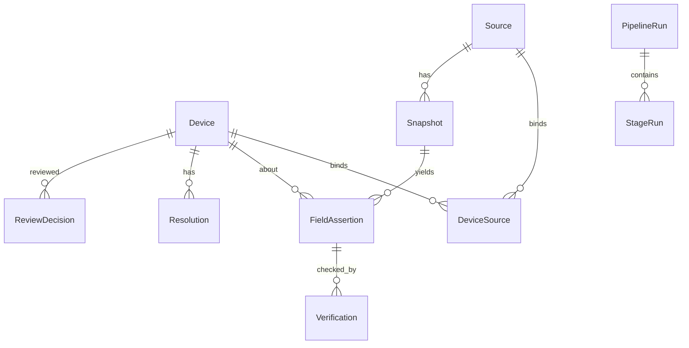
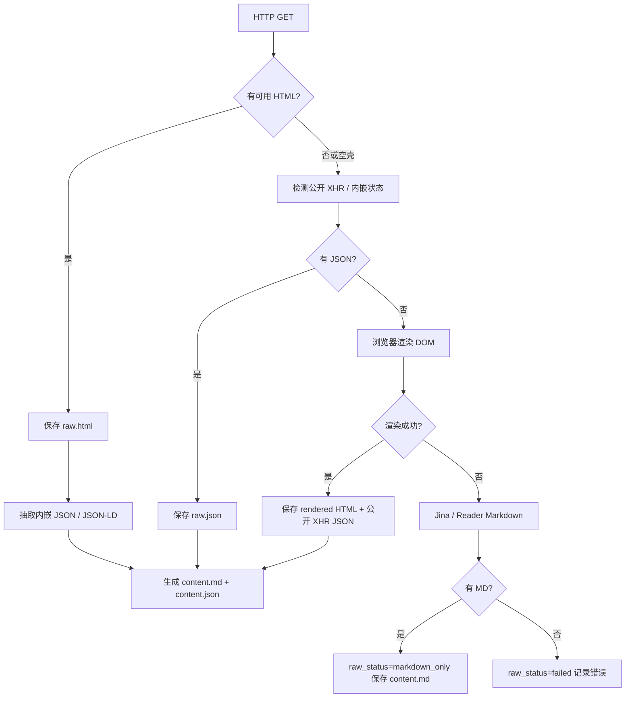

# terminal-insight-v2 技术设计

> 状态：Implementation-Ready  
> 上级文档：[ARCHITECTURE.md](./ARCHITECTURE.md)  
> 品类协议：[CATEGORY_TEMPLATE_SPEC.md](./CATEGORY_TEMPLATE_SPEC.md)

本文给出可直接指导开发的目录、数据模型、存储、阶段接口、状态机、审核、迁移与测试方案。

---

## 1. 仓库与目录

```text
terminal-insight-v2/
├── README.md
├── pyproject.toml
├── requirements.txt
├── .env.example
├── docs/
│   ├── ARCHITECTURE.md
│   ├── TECHNICAL_DESIGN.md
│   └── CATEGORY_TEMPLATE_SPEC.md
├── category_templates/          # 人类交付的 Excel 模板（唯一新品类入口）
│   ├── phone.xlsx
│   ├── watch.xlsx
│   └── glasses.xlsx
├── src/terminal_insight_v2/
│   ├── __init__.py
│   ├── cli.py                   # run --stage … / gui
│   ├── config.py
│   ├── orchestrator.py
│   ├── gui/                     # PyWebView 桌面壳（MVP）
│   │   ├── api.py               # JS bridge → orchestrator / store
│   │   ├── server.py
│   │   └── static/
│   ├── category/
│   │   ├── compiler.py          # Excel → category-schema.json
│   │   ├── loader.py            # 发现 / 校验 / 缓存 Schema
│   │   └── schema.py            # Pydantic CategorySchema
│   ├── models/                  # Device, Source, Snapshot, Assertion…
│   ├── store/
│   │   ├── db.py                # SQLite + migrations
│   │   ├── blobs.py             # content-addressed files
│   │   ├── wiki_paths.py
│   │   └── repositories.py
│   ├── stages/
│   │   ├── collect.py
│   │   ├── extract.py
│   │   ├── backfill.py
│   │   ├── verify.py
│   │   ├── excel.py
│   │   └── vote.py
│   ├── sourcing/                # URL 发现、官方域名、具名源、豆包
│   ├── fetch/                   # HTML/JSON/浏览器降级链
│   ├── identity/                # device_id、机型-URL 匹配
│   ├── review/                  # lock / reject / publish gold
│   ├── render/                  # sources.html、wiki 页面
│   └── migrate/                 # V1 导入
├── tests/
│   ├── contract_category_plugin/
│   │   └── fixtures/gadget.xlsx # 虚构第四品类
│   └── …
└── data/
    ├── runs/                    # 批次运行目录
    ├── memory/                  # facts.db + blobs + llm-wiki
    └── imports/                 # V1 导入暂存
```

### 1.1 运行时数据布局

```text
data/memory/
├── facts.db
├── blobs/
│   └── {sha256[0:2]}/{sha256}.{html|json|md}
└── llm-wiki/
    ├── raw/{device_id}/{source_id}/{snapshot_id}/
    │   ├── raw.html          # 可选
    │   ├── raw.json          # 可选（页面内嵌 / XHR）
    │   ├── content.md
    │   ├── content.json
    │   └── snapshot.json     # 元数据（指向 blob sha）
    ├── canonical/…
    ├── gold/…
    └── indexes/{research,report}/

data/runs/{category}_{date_start}-{date_end}_{timestamp}/
├── run.json
├── collection_manifest.json
├── sources.html
├── assertions.jsonl
├── coverage_report.json
├── verification.json
├── resolved.json
├── review_queue.json
├── {category}_{dates}.xlsx
├── votes.json
└── steps.json
```

约定：

- `llm-wiki/raw/...` 中的文件可以是 blob 的硬链 / 软链 / 元数据指针，**内容以 blobs 哈希为准**。
- 批次目录保存本轮交付视图；跨批次事实在 `facts.db`。

---

## 2. 核心数据模型

### 2.1 标识

| ID | 规则 |
|----|------|
| `device_id` | `{category}:{brand_norm}:{model_norm}`（复用 V1 归一化思路，增加可选 `region` 后缀） |
| `source_id` | `sha256(url_norm)` 截断或完整哈希 |
| `snapshot_id` | UUID；同一 URL 可有多次不可变快照 |
| `assertion_id` | UUID |
| `run_id` | 批次目录名或 UUID |

### 2.2 实体关系



### 2.3 SQLite 表（首期）

```sql
-- schema v1
CREATE TABLE devices (
  device_id TEXT PRIMARY KEY,
  category TEXT NOT NULL,
  brand TEXT NOT NULL,
  brand_norm TEXT NOT NULL,
  model TEXT NOT NULL,
  model_norm TEXT NOT NULL,
  region TEXT NOT NULL DEFAULT 'CN',
  release_date TEXT,
  status TEXT NOT NULL DEFAULT 'pending', -- pending|active|gold|rejected
  schema_id TEXT NOT NULL,               -- category schema fingerprint
  created_at TEXT NOT NULL,
  updated_at TEXT NOT NULL
);

CREATE TABLE sources (
  source_id TEXT PRIMARY KEY,
  url TEXT NOT NULL,
  url_norm TEXT NOT NULL UNIQUE,
  host TEXT,
  tier TEXT,           -- P0|P1|P2|P3
  source_kind TEXT,    -- official_spec|official_mall|named|third_party|search_clue
  global_status TEXT NOT NULL DEFAULT 'active', -- active|rejected
  first_seen TEXT NOT NULL,
  last_fetch TEXT
);

CREATE TABLE device_sources (
  device_id TEXT NOT NULL,
  source_id TEXT NOT NULL,
  link_role TEXT NOT NULL,  -- official_spec|official_mall|named:kkj|…
  identity_status TEXT NOT NULL DEFAULT 'unknown', -- unknown|match|mismatch|weak
  review_status TEXT NOT NULL DEFAULT 'auto', -- auto|approved|rejected|gold
  discovered_by TEXT,         -- discovery|doubao|manual|migrate
  not_available INTEGER NOT NULL DEFAULT 0, -- 官方槽位确认不存在
  batch_id TEXT,
  PRIMARY KEY (device_id, source_id, link_role)
);

CREATE TABLE blobs (
  blob_id TEXT PRIMARY KEY,
  sha256 TEXT NOT NULL UNIQUE,
  content_type TEXT NOT NULL,
  byte_size INTEGER NOT NULL,
  rel_path TEXT NOT NULL,
  created_at TEXT NOT NULL
);

CREATE TABLE snapshots (
  snapshot_id TEXT PRIMARY KEY,
  source_id TEXT NOT NULL,
  device_id TEXT,
  fetched_at TEXT NOT NULL,
  fetch_method TEXT NOT NULL, -- httpx|browser|jina|embedded_json|xhr_json|markdown_only
  http_status INTEGER,
  final_url TEXT,
  raw_status TEXT NOT NULL,   -- ok|partial|markdown_only|failed
  raw_html_blob TEXT,
  raw_json_blob TEXT,
  content_md_blob TEXT,
  content_json_blob TEXT,
  content_sha256 TEXT,
  converter_version TEXT,
  error TEXT,
  match_ok INTEGER NOT NULL DEFAULT 0
);

CREATE TABLE field_assertions (
  assertion_id TEXT PRIMARY KEY,
  device_id TEXT NOT NULL,
  field_name TEXT NOT NULL,
  value_text TEXT NOT NULL,
  value_norm TEXT,
  snapshot_id TEXT NOT NULL,
  source_id TEXT NOT NULL,
  snippet TEXT NOT NULL,
  extract_method TEXT NOT NULL, -- llm|adapter|rule|migrate
  confidence REAL,
  run_id TEXT NOT NULL,
  created_at TEXT NOT NULL
);
CREATE INDEX idx_assertions_device_field
  ON field_assertions(device_id, field_name);

CREATE TABLE verifications (
  verification_id TEXT PRIMARY KEY,
  assertion_id TEXT NOT NULL,
  identity_ok INTEGER NOT NULL,
  evidence_ok INTEGER NOT NULL,
  accuracy_status TEXT NOT NULL, -- supported|unsupported|uncertain
  notes TEXT,
  checked_at TEXT NOT NULL,
  checker TEXT NOT NULL          -- rule|llm|human
);

CREATE TABLE resolutions (
  device_id TEXT NOT NULL,
  field_name TEXT NOT NULL,
  display_text TEXT NOT NULL,    -- 可含「信源A：…；信源B：…」
  policy TEXT NOT NULL,          -- unanimous|multi_claim|locked|missing
  selected_assertion_ids TEXT NOT NULL, -- JSON array
  conflict INTEGER NOT NULL DEFAULT 0,
  locked INTEGER NOT NULL DEFAULT 0,
  locked_value TEXT,
  resolved_at TEXT NOT NULL,
  run_id TEXT NOT NULL,
  PRIMARY KEY (device_id, field_name, run_id)
);

CREATE TABLE review_decisions (
  decision_id TEXT PRIMARY KEY,
  scope TEXT NOT NULL,           -- device_source|source_global|field_lock|publish_device|publish_field
  device_id TEXT,
  source_id TEXT,
  field_name TEXT,
  action TEXT NOT NULL,          -- approve|reject|lock|unlock|publish_gold|revoke_gold
  value_text TEXT,
  note TEXT,
  actor TEXT NOT NULL,
  created_at TEXT NOT NULL
);

CREATE TABLE pipeline_runs (
  run_id TEXT PRIMARY KEY,
  category TEXT NOT NULL,
  schema_fingerprint TEXT NOT NULL,
  date_start TEXT,
  date_end TEXT,
  status TEXT NOT NULL,
  backfill_round INTEGER NOT NULL DEFAULT 0,
  input_revision TEXT NOT NULL,
  created_at TEXT NOT NULL,
  finished_at TEXT
);

CREATE TABLE stage_runs (
  stage_run_id TEXT PRIMARY KEY,
  run_id TEXT NOT NULL,
  stage TEXT NOT NULL,
  status TEXT NOT NULL,
  attempt INTEGER NOT NULL DEFAULT 1,
  input_revision TEXT NOT NULL,
  output_revision TEXT,
  error TEXT,
  started_at TEXT,
  finished_at TEXT,
  UNIQUE (run_id, stage, attempt)
);

CREATE TABLE category_schemas (
  schema_id TEXT PRIMARY KEY,
  category TEXT NOT NULL,
  version TEXT NOT NULL,
  fingerprint TEXT NOT NULL UNIQUE,
  template_path TEXT NOT NULL,
  compiled_json TEXT NOT NULL,
  compiled_at TEXT NOT NULL
);
```

**关键约束**：`field_assertions` **不以** `(record_id, field_name)` 唯一；同一字段允许多条断言。

---

## 3. 品类 Schema 运行时

1. 启动 / 运行前扫描 `category_templates/*.xlsx`。  
2. `CategorySchemaCompiler` 校验必填 Sheet 与列，失败则**字段级报错退出**（禁止静默猜测）。  
3. 写入 `category_schemas`，产物 `data/memory/compiled/{category}@{fingerprint}.json`。  
4. Orchestrator 绑定本次 `run.schema_fingerprint`；中途模板变更不影响在跑批次。

Schema 驱动：

| 能力 | 字段来源 |
|------|----------|
| 抽取 JSON Schema | `fields[].name/description/type/required` |
| 缺口检测 | `fields[].required` + coverage |
| 补链查询词 | `fields[].search_keywords` |
| 校验器 | `fields[].validators[]` |
| Excel 列序 | `output_columns[]` |
| Discovery 文案 | `category.discovery_*` |
| 信源偏好 | `sources[]`（可选 Sheet） |

详见 [CATEGORY_TEMPLATE_SPEC.md](./CATEGORY_TEMPLATE_SPEC.md)。

---

## 4. 阶段接口（Python 契约）

```python
class StageContext(BaseModel):
    run_id: str
    category: str
    schema: CategorySchema
    device_ids: list[str] | None = None  # None = 本批全部
    backfill_round: int = 0
    cancel_flag: Any = None

class StageResult(BaseModel):
    stage: str
    status: Literal["ok", "partial", "failed", "skipped"]
    output_revision: str
    metrics: dict[str, Any] = {}
    artifacts: dict[str, str] = {}  # name → path
    errors: list[str] = []
```

每个 Stage 实现：

```python
class Stage(Protocol):
    name: str
    def prereq(self, ctx: StageContext) -> None: ...
    def run(self, ctx: StageContext) -> StageResult: ...
```

CLI：

```bash
python -m terminal_insight_v2.cli run --category phone --stage all
python -m terminal_insight_v2.cli run --category phone --stage collect
python -m terminal_insight_v2.cli run --run-id <id> --stage extract,verify
python -m terminal_insight_v2.cli review approve-source --device ... --source ...
python -m terminal_insight_v2.cli review lock-field --device ... --field 起售价 --value '3999元'
python -m terminal_insight_v2.cli review publish-gold --device ...
python -m terminal_insight_v2.cli category compile --template category_templates/phone.xlsx
```

---

## 5. Stage 详设

### 5.1 Collect

**流程**

1. 加载机型清单（MD/JSON/迁移自 V1 discovery）。  
2. 填充官方槽位：`official_spec` / `official_mall`（存在必采；确认不存在则 `not_available=1`）。  
3. 具名权威源 + 其他第三方，目标约 10 源。  
4. 对每个 URL 执行抓取降级链（§6）。  
5. 写 blobs + snapshots + device_sources。  
6. 渲染 `sources.html` 与 `collection_manifest.json`。

**完成闸门**

- 每个设备有 `collection` 记录；  
- P0 槽位要么有成功快照，要么 `not_available`；  
- 每个成功快照至少有一种内容：`raw.html` / `raw.json` / `content.md`。

**幂等键**：`(device_id, url_norm, content_sha256)` — 内容未变则复用快照。

### 5.2 Extract

**流程**

1. 读取 `match_ok!=0` 且未拒绝绑定的快照。  
2. 按品类 Schema 构建抽取模型；**一源一调用**（或 adapter/rule 先填）。  
3. 每个非空字段写入独立 `FieldAssertion`（强制 snippet）。  
4. 导出 `assertions.jsonl`。

**禁止**：跨源合并覆盖；删除落选说法。

### 5.3 Backfill

**触发条件**（任一）：

- 必填字段 missing；  
- 关键字段（模板标记）evidence 不足；  
- Verify 要求补证。

**单轮**

```text
missing_fields → build Doubao queries → candidate URLs
  → Collect(new urls only) → Extract(new snapshots only) → coverage_delta
```

**停止**

- `backfill_round >= 3`；或  
- `coverage_delta == 0`；或  
- 无剩余可检索缺口。

搜索摘要 URL 标记 `source_kind=search_clue`，必须成功抓取正文后才可产生 assertion。

### 5.4 Verify

**两层校验**

1. **Identity**：页面标题/正文/URL 路径是否匹配目标机型（规则 + 可选 LLM）。失败 → `identity_status=mismatch`，断言不进入 Resolution 采纳集。  
2. **Evidence**：snippet 是否支持 `value_text`；字段 validators（正则 / 类型）是否通过。

**冲突策略**

- 说法一致 → `policy=unanimous`，取高 tier 或并列引用；  
- 说法不同 → `policy=multi_claim`，`display_text` 形如：

  ```text
  官网参数页：典型容量8000mAh，支持80W；
  快科技：实测标称8000mAh；
  ZOL：7800mAh
  ```

- 字段已 lock → `policy=locked`，冲突只记 issue。

输出：`verification.json`、`resolved.json`、`coverage_report.json`、`review_queue.json`。

### 5.5 Excel

Sheet 建议：

| Sheet | 内容 |
|-------|------|
| `{品类}参数` | Resolution.display_text（研究批次）或 Gold 值（对外批次，由 flag 控制） |
| `字段信源` | field → urls / assertion ids |
| `冲突与校验` | issues、mismatch、locked |
| `亮点投票` | Vote 写入 |

**对外模式**（`--report gold`）：空 Gold 字段留空，不得回填 Canonical。

### 5.6 Vote

- 输入：`resolved.json` 压缩投影（去掉空缺与纯 identity 噪音）+ `input_revision`。  
- **AAA–FFF 六套参考系并行**：每人按自己的参考系 × 取景框提名 2–3 个热点；禁止同质化。  
- 轻量方向聚类写入 `votes.json.clusters`，合并频次时保留「谁用哪套轴」。  
- 回填 Excel「亮点投票」：`参考系 | 取景框 | 热点 | 品牌 | 机型 | 说明`。  
- 若 `input_revision` 变化 → 覆盖旧 `votes.json`，不与旧票合并。  
- 不联网搜新机；缺少 `resolved.json` 或 `OPENAI_API_KEY` 则失败（不再 stub skip）。

---

## 6. 抓取降级链



规则：

- **禁止**伪造 HTML；  
- `markdown_only` 仍可进入 Extract，但证据等级低于含 raw 的快照；  
- 每次记录：`fetch_method`、`http_status`、`final_url`、`fetched_at`、hashes、`error`。

---

## 7. 审核 API 与失效传播

| 操作 | 效果 |
|------|------|
| `approve-source` | `device_sources.review_status=approved/gold` |
| `reject-binding` | 绑定 rejected；相关 assertions 不参与 Resolution；触发 verify 重算 |
| `reject-source-global` | `sources.global_status=rejected` |
| `lock-field` | resolutions 标记 locked；后续 extract/backfill 不可覆盖 display |
| `unlock-field` | 解除锁定 |
| `publish-gold` | 设备/字段进入 gold 层与 report index |
| `revoke-gold` | 降级并标记 wiki stale |

失效：写入 `review_decisions` 后，Orchestrator 使下游 `stage_runs` 过期，并可选自动重跑 verify→excel。

---

## 8. 产物契约

所有 JSON 顶层必须含：

```json
{
  "schema_version": 1,
  "run_id": "...",
  "category": "phone",
  "schema_fingerprint": "...",
  "input_revision": "...",
  "generated_at": "ISO-8601"
}
```

| 产物 | 生产者 | 消费者 |
|------|--------|--------|
| `collection_manifest.json` | Collect | Extract / 人工 |
| `sources.html` | Collect | 人工信源审核 |
| `assertions.jsonl` | Extract / Backfill | Verify |
| `coverage_report.json` | Verify / Backfill | Backfill 决策 |
| `verification.json` | Verify | 人工 / Excel |
| `resolved.json` | Verify | Excel / Vote |
| `*.xlsx` | Excel | 业务交付 |
| `votes.json` | Vote | Excel Sheet2 |

---

## 9. V1 迁移

| V1 来源 | V2 映射 | provenance_level |
|---------|---------|------------------|
| `discovery.md/json` | devices + device_sources | `v1_discovery` |
| `rag/*.md` / memory blobs | snapshots（常为 markdown_only） | `v1_blob` |
| `extracted._meta.field_evidence` | field_assertions（可能缺 snapshot） | `v1_meta_partial` |
| 标准 `validated.json` | resolutions 草案 | `v1_validated` |
| legacy merged validated | record only | `v1_legacy_lossy` |
| `overrides.json` | field locks | `v1_human_lock` |

规则：`provenance_level != human_gold` 且证据链不完整 → **禁止**自动 `publish-gold`。

---

## 10. 配置（`.env` 摘要）

```env
CATEGORY=phone
DATE_START=2026-07-01
DATE_END=2026-07-31
DATA_ROOT=./data
TEMPLATE_DIR=./category_templates
EXTRACT_TARGET_SOURCES=10
BACKFILL_MAX_ROUNDS=3
DOUBAO_API_KEY=
OPENAI_API_KEY=
OPENAI_BASE_URL=
OPENAI_MODEL=
COLLECT_MAX_WORKERS=4
DOUBAO_MAX_QPS=4
REPORT_MODE=research   # research|gold
```

---

## 11. 测试策略

### 11.1 单元

- URL 归一化、device_id、冲突 display 格式化  
- 抓取降级状态机  
- Schema 编译与校验错误定位  
- 补链停止条件  

### 11.2 集成

- 单机：Collect→Extract→Verify→Excel  
- 三轮补链账本  
- 拒绝绑定后 Resolution 不含该源  
- lock-field 后重跑不被覆盖  

### 11.3 契约：品类插件

1. 仅添加 `tests/.../gadget.xlsx`（虚构品类）；  
2. 不改业务代码；  
3. 编译 Schema → 跑通六阶段 mock（fixtures）；  
4. 模板缺列时必须失败并指出 Sheet/列名。

### 11.4 黄金样本（真机）

覆盖：官方齐全、官网缺失、同名地区版、参数冲突、强反爬。  
验收：Gold 非空字段证据 100%；错机型 Gold=0；Excel 可重建。

---

## 12. 从 V1 复用清单（实现时）

可移植参考（复制/改编，而非 import 耦合）：

- `terminal_insight/categories/*` 字段经验 → 首期三个 Excel 模板内容  
- `adapters/*`、`url_identity.py`、`doubao_search.py`、`excel_writer.py` Vote 提示词  

明确丢弃：Infini、RAG serve/run 栈、`EXTRACT_MAX_SOURCES=5` 作为硬上限、Excel 回读 validated。

---

## 13. 实现顺序建议

1. `store` + migrations + blobs  
2. `category` compiler + phone/watch/glasses 模板  
3. Collect + sources.html  
4. Extract assertions  
5. Verify + Resolution  
6. Backfill 循环  
7. Excel + Vote  
8. Review CLI + Gold publish  
9. V1 migrate + 契约测试  

接口与表结构若需微调，必须同步更新本文 `schema_version` 与产物契约，并保持 [ARCHITECTURE.md](./ARCHITECTURE.md) 原则不变。
